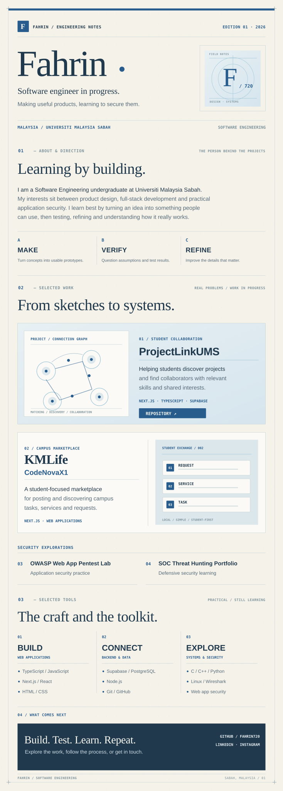

<!-- The full profile is presented as one continuous illustrated SVG.
     GitHub embeds SVG as an image, so clickable links stay beneath it. -->

<a href="https://github.com/Fahrin720/ProjectLinkUMS">ProjectLinkUMS</a> &nbsp;·&nbsp;
<a href="https://github.com/Fahrin720/CodeNovaX1">KMLife / CodeNovaX1</a> &nbsp;·&nbsp;
<a href="https://github.com/Fahrin720/owasp-webapp-pentest-lab">Security Lab</a> &nbsp;·&nbsp;
<a href="https://github.com/Fahrin720/soc-threat-hunting-portfolio">SOC Portfolio</a>

<a href="https://www.linkedin.com/in/mohamed-fahrin-bin-mohamed-muneer">LinkedIn</a> &nbsp;·&nbsp;
<a href="https://www.instagram.com/zvx_fahrin/">Instagram</a>

