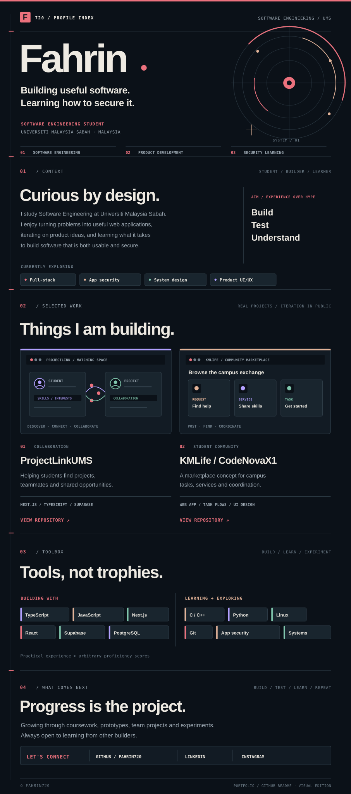

<!-- Full profile layout is rendered as one continuous SVG canvas. -->

  

Open project links and contact details

### Projects
- [ProjectLinkUMS — repository](https://github.com/Fahrin720/ProjectLinkUMS)
- [KMLife / CodeNovaX1 — repository](https://github.com/Fahrin720/CodeNovaX1)

### Connect
- [GitHub profile](https://github.com/Fahrin720)
- [LinkedIn](https://www.linkedin.com/in/mohamed-fahrin-bin-mohamed-muneer)
- [Instagram](https://www.instagram.com/zvx_fahrin/)

