[GitHub](https://github.com/Fahrin720) &nbsp; / &nbsp; [LinkedIn](https://www.linkedin.com/in/mohamed-fahrin-bin-mohamed-muneer)

## 01 / About

I build web applications, explore practical cybersecurity, and enjoy learning how thoughtful design meets reliable engineering. Currently studying Software Engineering at Universiti Malaysia Sabah.

**Currently exploring**  
`Software Engineering` · `Cybersecurity` · `Systems & Architecture`

## 02 / Selected work

### 01 / [ProjectLinkUMS](https://github.com/Fahrin720/ProjectLinkUMS)
Ai Studio Integrated ProjectLink UMS  
TypeScript · 0 stars

### 02 / [owasp-webapp-pentest-lab](https://github.com/Fahrin720/owasp-webapp-pentest-lab)
Explore the repository and source code.  
Python · 0 stars

### 03 / [soc-threat-hunting-portfolio](https://github.com/Fahrin720/soc-threat-hunting-portfolio)
Explore the repository and source code.  
Python · 0 stars

### 04 / [CodeNovaX1](https://github.com/Fahrin720/CodeNovaX1)
The latest version of KMLife  
TypeScript · 0 stars

## 03 / Tools & technologies

`TypeScript` · `JavaScript` · `Python` · `C / C++` · `Next.js` · `Supabase` · `PostgreSQL` · `Git & GitHub` · `React` · `Wireshark` · `Linux` · `HTML / CSS` · `Node.js`

---

Always building, always learning. See more at [github.com/Fahrin720](https://github.com/Fahrin720).
